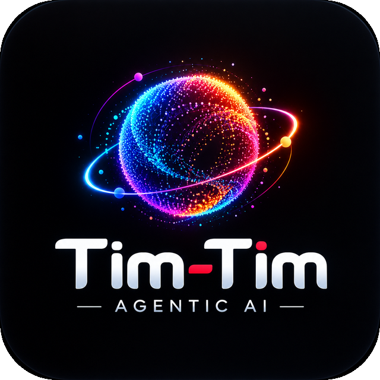

<p align="center"></p>

# Tim-Tim 1.0

**Your agentic AI companion.** Talk to it, give it tasks, get live answers. Made by Zaftan Studios.

- **Voice and chat**: hold Space (or the mic button) and talk; Tim-Tim answers out loud and you can interrupt it.
- **Live knowledge**: it searches the web for news, prices and "latest" questions, and does deep research on request, with sources.
- **Agent team**: Research, Coding, Creative and Planner agents, picked automatically.
- **Memory**: remembers what you ask it to, editable by you.
- **Computer actions** (desktop app): open apps, search, files, reminders, volume, typing... every action asks first.
- **WhatsApp by voice**: "message Mom on WhatsApp..." opens the chat with your text ready, after you confirm ([what it can and can't do](WHATSAPP.md)).
- **Free to start**: free daily limit on shared free AI services; **Pro** (granted by the owner) lets you add your own API keys.
- **Everywhere**: Windows app, Android app, and any browser (install it from the browser like an app).

## Run it
| You want to... | Read |
|---|---|
| **Launch to users** (checklist) | [LAUNCH-CHECKLIST.md](LAUNCH-CHECKLIST.md) |
| Host the website + phone web app (free) | [RENDER-DEPLOY.md](RENDER-DEPLOY.md) |
| Make the **Windows desktop app** (installer) | [DESKTOP-APP.md](DESKTOP-APP.md) |
| Make the **Android app** / install on iPhone | [MOBILE-APP.md](MOBILE-APP.md) |
| First-time setup on your own PC | [START-HERE.md](START-HERE.md), [SETUP-SIGNIN.md](SETUP-SIGNIN.md) |
| Free AI providers and their limits | [README-PROVIDERS.md](README-PROVIDERS.md) |

## What is in this folder
```
backend/    FastAPI server: sign-in check, daily limits, AI/voice provider rotation, agents, memory, live search, admin
desktop/    the app itself (desktop/src is plain HTML/JS: it IS the website) + the Tauri shell that makes the Windows installer
mobile/     Android app (Flutter wrapper around the website)
supabase/   database tables and security rules
scripts/    icon generator
docs/       history and developer notes
*.bat       one-click helpers for Windows (setup, run, build)
```
Change the logo: replace `desktop/logo-source.png`, then run `python scripts/make_icons.py`.

Version history: [CHANGELOG.md](CHANGELOG.md). Privacy policy and terms: `desktop/src/privacy.html`, `desktop/src/terms.html` (templates: have a lawyer review them).
